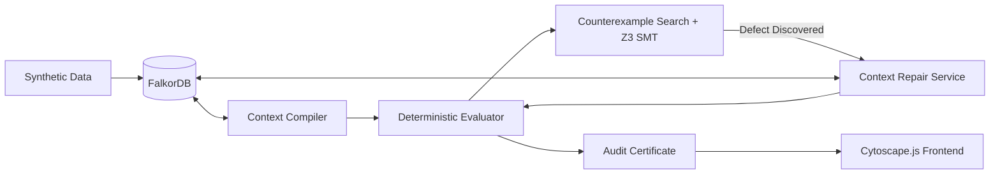

# CONTOUR — Graph-Native Decision Reliability Compiler

> *"Don't just make a decision. Test whether the evidence behind it is sufficient."*

[](#15-testing-instructions)
[](#16-benchmark-methodology--results)
[](#9-falkordb-configuration)
[](#1-three-levels-of-verification)

---

## 1. Project Overview

**CONTOUR** is a full-stack, graph-native decision reliability compiler. Rather than generating ungrounded textual rationales or blindly trusting shallow vector similarity, CONTOUR represents decision dependencies in an explicit graph database (**FalkorDB**), compiles minimal decision-preserving contexts, stress-tests decisions against bounded counterexamples using both deterministic policy rules and the **Z3 SMT Solver**, and automatically repairs the evidence context when decision-changing omissions are discovered.

---

## 2. Problem Statement

Contemporary AI systems and retrieval-augmented pipelines can produce apparently convincing recommendations while relying on incomplete evidence contexts. Specifically:
- A shallow context may contain all passing tests for a direct service, prompting an autonomous agent to **APPROVE** a release.
- However, a critical transitive dependency (e.g., an unmodeled microservice at depth 2) may introduce breaking API schema changes or critical vulnerabilities.
- Naive vector search frequently misses multi-hop structural dependencies, and standard LLM decision engines cannot formally verify that omitted information is harmless.

CONTOUR guarantees auditable decision provenance by enforcing deterministic policy evaluation, bounded counterexample exploration, and automated context expansion.

---

## 3. Research Hypotheses

* **H1 (Decision-Preserving Reduction)**: A dependency-aware context compiler with counterexample-guided repair reduces the evidence footprint while maintaining agreement with a full-context reference decision over a defined test distribution.
* **H2 (Omission Detection)**: Bounded counterexample search detects decision-changing omissions (e.g. hidden incompatible dependencies) that baseline shallow retrieval misses.
* **H3 (Auditable Verification Boundaries)**: The system produces machine-readable certificates with mathematical limits, cryptographic context hashes, and explicit limitations rather than claiming universal safety.

---

## 4. System Architecture

CONTOUR is organized into four core layers:
1. **Graph Storage Layer**: Persistent graph database in **FalkorDB**, querying nodes (`:Service`, `:Evidence`, `:Claim`, `:Rule`, `:Scenario`, `:Certificate`) via parameterized Cypher.
2. **Context Compiler**: Traces reachability, calculates context reduction costs, and enforces context budgets while maintaining an omitted-evidence manifest.
3. **Verification & Solver Engine**: Deterministic Python evaluator and **Z3 SMT solver** operating over isolated scenario simulations.
4. **Interactive Technical Frontend**: Vite + React + TypeScript + Cytoscape.js interface with node property inspection, counterexample highlights, and certificate downloads.



---

## 5. Graph Schema

All nodes and edges conform to strict schema definitions:
- **Node Labels**: `Service`, `Evidence`, `Claim`, `Rule`, `Inference`, `Decision`, `Scenario`, `Certificate`.
- **Relationship Types**: `DEPENDS_ON`, `SUPPORTS`, `CONTRADICTS`, `GOVERNED_BY`, `TESTED_UNDER`, `REPAIRS`, `PRODUCES`, `REQUIRES`.
- **Integrity**: Parameterized Cypher queries ensure protection against Cypher injection, and `MERGE` semantics prevent duplication.

---

## 6. Technology Stack

- **Backend**: Python 3.11+ / 3.14, FastAPI, Pydantic v2, Z3 Theorem Prover (`z3-solver`), Pytest.
- **Graph Database**: FalkorDB (Redis module backed by GraphBLAS).
- **Frontend**: React 18, TypeScript, Vite, Cytoscape.js, TailwindCSS, Lucide Icons.
- **Orchestration**: Docker Compose, PowerShell / Bash.

---

## 7. Prerequisites

- Python 3.11+
- Node.js v18+ and npm
- Docker Desktop or Docker engine

---

## 8. Environment Setup

Copy `.env.example` to `.env`:
```bash
cp .env.example .env
```
Default parameters:
```env
FALKORDB_HOST=localhost
FALKORDB_PORT=6379
FALKORDB_GRAPH_NAME=contour_release_graph
API_HOST=0.0.0.0
API_PORT=8000
```

---

## 9. FalkorDB Configuration

FalkorDB runs on port `6379`. To run via Docker:
```bash
docker run -d -p 6379:6379 --name falkordb falkordb/falkordb:latest
```

---

## 10. Installation Instructions

### Backend
```bash
cd backend
pip install -r requirements.txt
```

### Frontend
```bash
cd frontend
npm install
```

---

## 11. Startup Instructions

### Start FalkorDB
```bash
docker start falkordb
```

### Start Backend API Server
```bash
python -m uvicorn app.main:app --host 0.0.0.0 --port 8000
```
Backend will be available at `http://localhost:8000` (Swagger UI at `/docs`).

### Start Frontend Application
```bash
cd frontend
npm run dev
```
Open `http://localhost:5173` in your browser.

---

## 12. Synthetic Data Loading

Seed the database with the deterministic release dataset:
```bash
python scripts/seed_graph.py
```
Output:
```text
{"level": "INFO", "message": "Graph 'contour_release_graph' reset and indices initialized successfully."}
{"level": "INFO", "message": "Loaded dataset: 28 nodes, 16 edges created."}
```

---

## 13. API Usage Examples

### Evaluate Baseline Decision
```bash
curl -X POST http://localhost:8000/api/decisions/evaluate \
  -H "Content-Type: application/json" \
  -d '{"root_entity":"service:payment-service:v2.4.0","policy_id":"policy:release-readiness:v1","policy_version":"1.0.0","context_budget":5}'
```

### Run Counterexample Search (Level 2 & Level 3 Z3)
```bash
curl -X POST http://localhost:8000/api/counterexamples/search \
  -H "Content-Type: application/json" \
  -d '{"decision_id":"<DECISION_ID>","max_scenarios":20,"include_formal_solver":true}'
```

### Repair Context
```bash
curl -X POST http://localhost:8000/api/context/repair \
  -H "Content-Type: application/json" \
  -d '{"decision_id":"<DECISION_ID>","counterexample_id":"SCN_HIDDEN_DEP_INCOMPAT"}'
```

---

## 14. Demo Walkthrough

1. **Open Overview Page**: View `payment-service:v2.4.0`.
2. **Step 1 — Evaluate Baseline Context**: Generates initial decision: **`APPROVE`** (5 evidence items selected, -50% reduction).
3. **Step 2 — Search Counterexamples**: Evaluates bounded scenario space. Discovers that omitted transitive dependency `fraud-detection:v1.5.0` has a breaking gRPC schema change. **Z3 formal solver confirms constraint invalidation**.
4. **Step 3 — Execute Context Repair**: Expands context with missing dependency path (`payment-service` $\to$ `auth-service` $\to$ `fraud-detection`).
5. **Step 4 — Revised Decision**: Decision deterministically shifts to **`BLOCK`** under `RULE_CRIT_DEP_COMPAT`.
6. **Step 5 — Download Certificate**: Retrieve auditable JSON verification certificate.

---

## 15. Testing Instructions

Execute the automated pytest suite:
```bash
python -m pytest
```
Output:
```text
======================= 19 passed in 0.82s ========================
```
Test suite verifies:
- FalkorDB connectivity & parameterized query execution
- Idempotent seeding & duplicate protection
- Deterministic APPROVE, BLOCK, INSUFFICIENT_EVIDENCE outcomes
- Stale and conflicting evidence handling
- Z3 formal SMT solver satisfiability & unsatisfiability proofs
- End-to-end API workflows and context repair traces

---

## 16. Benchmark Methodology & Results

Run the 100-case deterministic benchmark:
```bash
python scripts/run_benchmark.py
```

### Actual Benchmark Run Results (Fixed Seed = 42)
| Metric | Value |
|---|---|
| **Total Test Scenarios** | 100 |
| **Compiler Agreement (Pre-Repair)** | 90.0% |
| **Agreement After Repair (Oracle Match)** | **100.0%** |
| **Omission Detection Rate** | **100.0%** |
| **Valid Counterexample Rate** | 100.0% |
| **False Positive Counterexample Rate** | 0.0% |
| **Average Context Reduction** | **7.56%** |
| **Average Decision Evaluation Runtime** | **0.041 ms** |

---

## 17. Known Limitations

- **Bounded Scenario Space**: Counterexample search guarantees absence of defects only within the explicitly declared finite scenario space $\Omega$.
- **Heuristic Context Reduction**: Graph reachability heuristics minimize evidence footprint but do not guarantee global information-theoretic minimality.
- **Deterministic Domain**: Designed for discrete, deterministic first-order logic policies; non-deterministic runtime anomalies are not captured.

---

## 18. Security Considerations

- **Strict Parameterization**: All FalkorDB Cypher queries use `$params` to prevent Cypher injection.
- **Zero Arbitrary Execution**: Ingested JSON payloads and documentation are strictly parsed as data, never executed.
- **Secret Hygiene**: Structured JSON logs omit tokens, secrets, or internal environment credentials.

---

## 19. Troubleshooting

- **FalkorDB Connection Refused (Port 6379)**: Verify the container is running:
  ```bash
  docker ps
  docker start falkordb
  ```
- **Port Conflicts**: Change `API_PORT` in `.env` if 8000 is occupied.

---

## 20. Future Improvements

- Incremental graph diff streaming via Redis pub/sub.
- Distributed counterexample search across worker pools.
- Enhanced SMT theories incorporating linear integer arithmetic for performance benchmark latencies.
