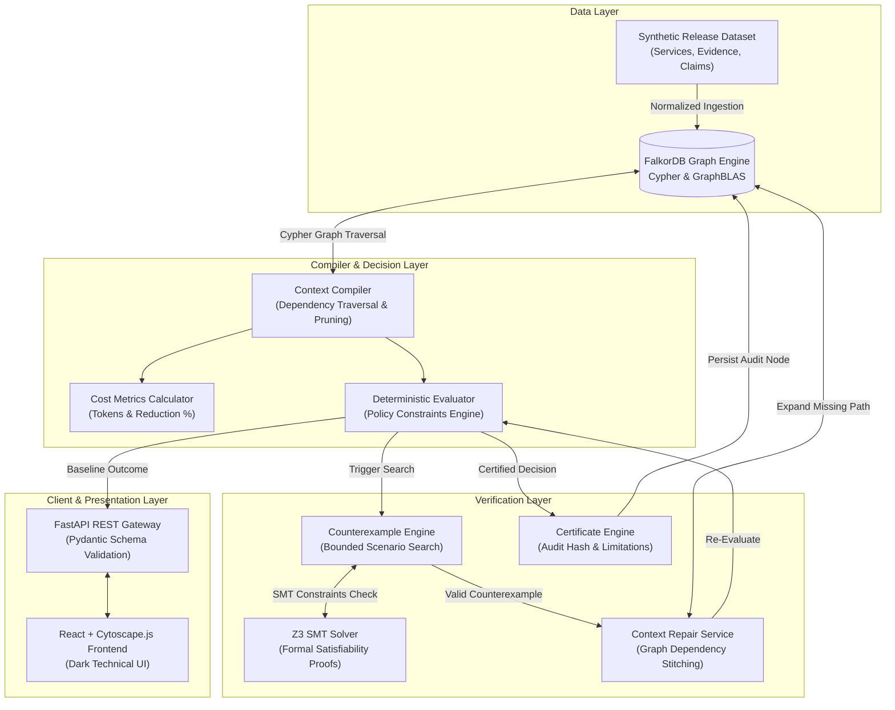

# CONTOUR — System Architecture & Data Flow

## 1. Executive Summary

**CONTOUR** is a Graph-Native Decision Reliability Compiler. It addresses a fundamental failure mode in contemporary AI decision systems: *an agent or policy engine can produce a convincing, apparently correct recommendation while relying on incomplete evidence, silently ignoring a decision-changing dependency.*

CONTOUR solves this by:
1. Representing evidence and dependencies in **FalkorDB** (a high-performance Redis-based graph database).
2. Compiling candidate context subgraphs to minimize context cost.
3. Evaluating decisions using deterministic, first-order policy constraints.
4. Performing bounded counterexample search and formal constraint checking with **Z3 SMT Solver**.
5. Executing counterexample-guided context repair to expand the evidence subgraph until decisions are verified or safely blocked.
6. Producing cryptographically hashed, machine-readable verification certificates with explicit limitation boundaries.

---

## 2. Component Architecture

---

## 3. Data Flow Stages

### Stage 1: Context Compilation
Given a release candidate entity $E_{root}$ and policy $P$, the Context Compiler retrieves the local $k$-hop dependency tree from FalkorDB. Evidence items are scored and prioritized:
1. Direct mandatory unit & integration tests of $E_{root}$.
2. Direct security vulnerability audits of $E_{root}$.
3. Compatibility verifications of direct critical dependencies ($d \in \text{Deps}(E_{root}), \text{critical} = \text{true}$).
4. Optional metrics (perf benchmarks, documentation) subject to context budget constraints.

### Stage 2: Deterministic Policy Evaluation
The explicit release policy enforces rules:
- `RULE_CRIT_DEP_COMPAT`: Critical dependencies must have passing compatibility checks.
- `RULE_MANDATORY_TESTS_PASS`: Mandatory test suites must pass.
- `RULE_SECURITY_AUDIT_PASS`: Security scans must be clean.
- `RULE_NO_CONFLICTING_EVIDENCE`: Contradictory evidence is blocked.
- `RULE_NO_STALE_EVIDENCE`: Expired timestamps are rejected.

Precedence logic:
$$\text{Outcome} = \begin{cases} \text{BLOCK} & \text{if } \exists r \in \text{MandatoryRules}, \text{status}(r) \in \{\text{FAILED}, \text{CONFLICT}\} \\ \text{INSUFFICIENT\_EVIDENCE} & \text{else if } \exists r \in \text{MandatoryRules}, \text{status}(r) = \text{MISSING\_EVIDENCE} \\ \text{APPROVE} & \text{otherwise} \end{cases}$$

### Stage 3: Counterexample Search & Z3 Verification
The Counterexample Engine evaluates candidate scenarios from the declared scenario space against an isolated state. When an omitted critical dependency (e.g. `fraud-detection`) is tested:
- Z3 formalizes the specification: $\text{Approve} \iff (\bigwedge \text{MandatoryRules})$.
- Z3 asserts $\neg \text{Compat}(\text{fraud-detection}) \land \text{Approve}$.
- Z3 returns `unsat`, proving that under this scenario, $\text{Approve}$ is mathematically impossible and release must be blocked.

### Stage 4: Context Repair & Certification
1. The missing evidence node and dependency path are fetched from FalkorDB.
2. Context is expanded with required nodes and relationships.
3. Deterministic evaluator recalculates the outcome ($\text{APPROVE} \to \text{BLOCK}$).
4. An auditable, SHA-256 hashed certificate is generated and persisted.
